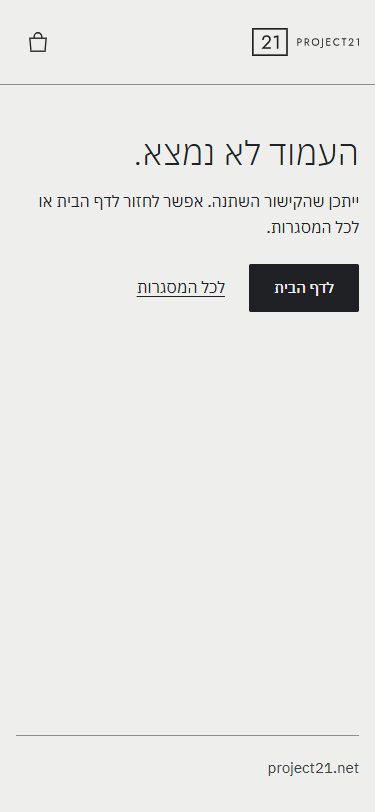
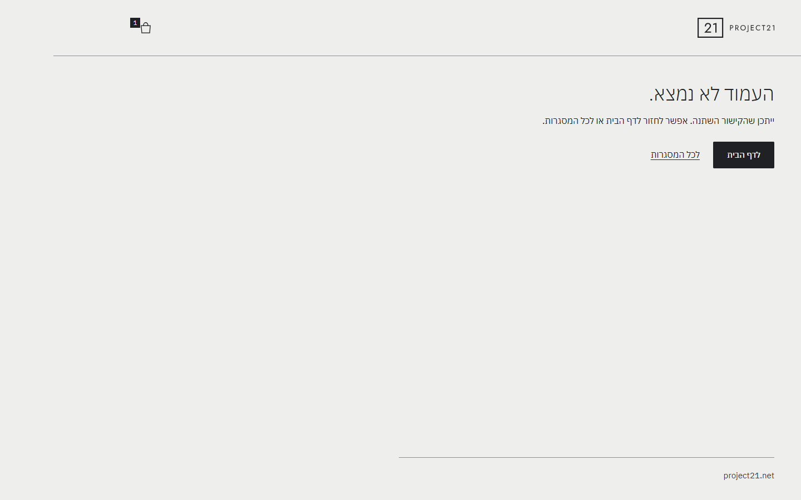
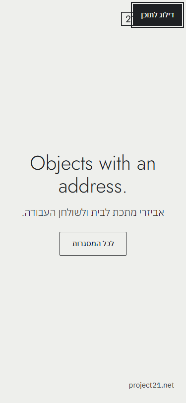
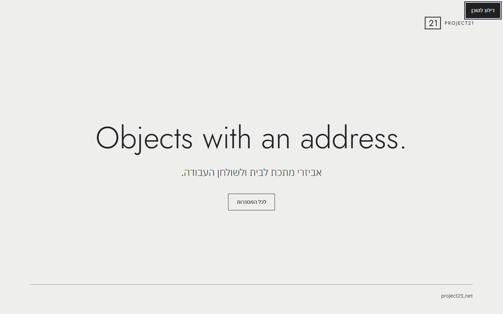
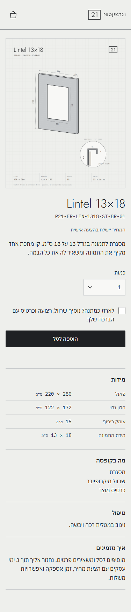
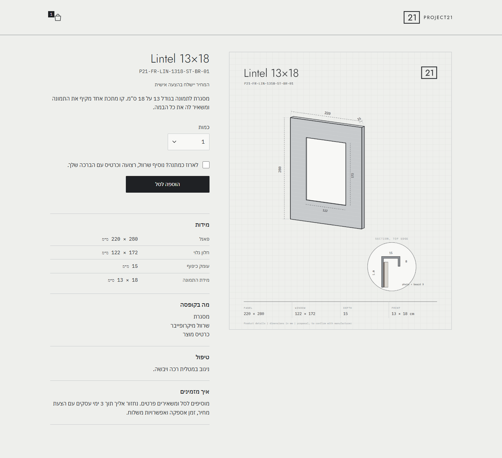
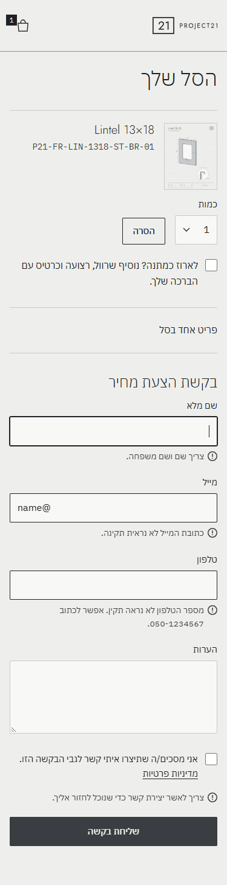
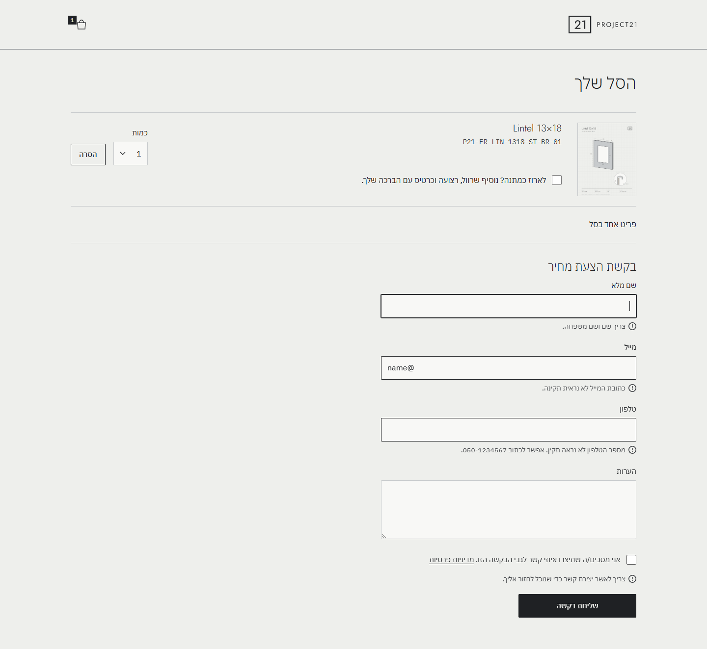

# דוח תאימות: ענף `compliance`

תאריך: 18.10.2026. הבסיס הוא master בקומיט `885275e`, אחרי הסרת "בקרוב." מדף הבית. השינוי הזה עלה לאוויר ונבדק: השורה כבר לא מופיעה ב-project21.net.

כל העבודה בדוח נעשתה בענף `compliance` בלבד. היא כוללת commit מקומי, ולא נעשו push או merge. שלבים 1 ו-2 (פרטי עסק ועמודים משפטיים) לא בוצעו, לפי ההוראה.

**כלי בדיקה:** puppeteer-core 23.11.1 ו-axe-core 4.10.2, שהותקנו בתיקייה זמנית מחוץ לריפו. הבדיקות רצו מול שרת מקומי שמחקה את GitHub Pages, כולל הצגת `404.html` בכתובת שלא קיימת.

---

## שלב 0: סקירה

### 0.1 הטמעות צד שלישי
**לא נמצאה אף בקשת רשת לדומיין חיצוני** באף אחד מ-8 העמודים שנבדקו.

| משאב | מקור | הכרחי? |
|---|---|---|
| גופנים (Plex Hebrew, Jost, Plex Mono) | `/assets/fonts/` מקומית. Google Fonts הוסר בשלב 1 של המשימה הקודמת | כן |
| לוגו, favicon, שרטוטים | `/assets/` מקומית | כן |
| אייקונים בתוך ה-CSS | `data:` URI בתוך הקובץ, בלי בקשת רשת | כן |
| שליחת טופס | `https://api.project21.net/quote` (Cloudflare Worker). נקרא רק בלחיצה על שליחה, ולא בטעינת עמוד. עדיין לא מוגדר | כן, זה מנגנון הצעת המחיר |

אין סקריפטים חיצוניים, iframe, pixel, אנליטיקה או ווידג'טים.

### 0.2 מעקבים ואחסון
| סוג | שם | מה נשמר | למה | כמה זמן |
|---|---|---|---|---|
| עוגיות | — | **אין עוגיות** (נבדק בכל העמודים) | — | — |
| localStorage | `p21_cart_v1` | פריטי הסל: id, sku, כמות, מתנה, ברכה. בלי פרטים אישיים | הסל נשמר בין טעינות | עד שהסל מתרוקן או שהמשתמש מנקה את הדפדפן |
| sessionStorage | `p21_last_quote` | מספר הבקשה ורשימת פריטים (שם, כמות, מתנה). בלי פרטים אישיים | הצגת עמוד התודה | עד סגירת הלשונית |
| IndexedDB | — | לא בשימוש | — | — |

### 0.3 איסוף מידע: טופס בקשת הצעת מחיר (עמוד `/cart/`)
| שדה | חובה | לאן נשלח |
|---|---|---|
| שם מלא | כן | ל-Worker ב-`api.project21.net`, שמשם הוא נשלח במייל לכתובת ה-Gmail המאומתת ונשמר עותק ב-D1. כרגע לא מחובר באתר החי (ה-Worker לא הוגדר) |
| מייל | כן | כנ"ל, ומשמש גם כ-Reply-To |
| טלפון | כן | כנ"ל, מנורמל ל-E.164 |
| הערות | לא | כנ"ל |
| הסכמה ליצירת קשר | כן | נשלח כ-`true` ונבדק בשרת |
| honeypot ‏(`company`) | — | מוסתר. אם מולא, הבקשה לא נשמרת ולא נשלחת |
| נלווה לכל בקשה | — | פריטי הסל, מספר בקשה, זמן וכתובת העמוד. בשרת נשמר גם גיבוב של כתובת ה-IP, להגבלת קצב בלבד |

עוד טפסים באתר: בורר כמות וסימון מתנה עם ברכה בעמוד המוצר ובסל. הם נשמרים רק ב-localStorage.

### 0.4 כפתורים וקישורים
| עמוד | כפתור או קישור | ברור? |
|---|---|---|
| בית | "לכל המסגרות" | כן |
| כל העמודים הפנימיים | לוגו, שמו הנגיש "Project21" ומוביל לדף הבית | כן (ראו שאלה 6) |
| כל העמודים הפנימיים | אייקון סל, שמו הנגיש "לסל" או "לסל, N פריטים" | כן |
| מסגרות | "הכל", "רגיל", "רצועה", "חלון עליון", "ריבוע", "פינה" (`aria-pressed`) | כן, בתוך תווית "סינון לפי פריסה" |
| מסגרות | כרטיס מוצר: שם ו"בהצעה אישית" | כן |
| מוצר | "הוספה לסל" | כן |
| מוצר | הודעה "נוסף לסל" עם קישור "לסל" | כן |
| סל | "הסרה" (שם נגיש: "הסרה של Lintel …") | כן |
| סל | "בקשת הצעת מחיר" | כן |
| סל | **"שליחת בקשה"** | ⚠ סביר, אבל הפרומט מבקש "שליחת בקשה להצעת מחיר". ראו שאלה 1 |
| סל | "מדיניות פרטיות" | כן |
| סל (כשל) | `info@project21.net` | כן |
| תודה | "לכל המסגרות" | כן |

לא נמצאו כפתורים עם טקסט כללי כמו "לחץ כאן", "שלח" לבד או "המשך".

### 0.5 נגישות: בדיקה ראשונית מול WCAG 2.1 AA
**axe-core** (תגיות wcag2a, wcag2aa, wcag21a, wcag21aa ו-best-practice): **0 הפרות** בכל העמודים הקיימים. ב-`/no-such-page/` הוצג דף השגיאה של הדפדפן, כי עוד לא היה `404.html`.

בעיות שנמצאו בבדיקה ידנית, לפי חומרה:

| חומרה | בעיה | קריטריון | סטטוס |
|---|---|---|---|
| גבוהה | אין קישור "דילוג לתוכן" | 2.4.1 | **תוקן** |
| גבוהה | שגיאות הטופס לא הוכרזו כ-live region. הן נקשרו רק ב-`aria-describedby` והפוקוס עבר לשדה הראשון | 4.1.3 | **תוקן** |
| בינונית | מסגרת שדות הטקסט והסינונים בצבע silver על רקע paper/mist: ניגודיות 1.5:1. נדרש 3:1 לגבולות רכיב | 1.4.11 | **לא תוקן.** זה כלל מספר המותג. ראו שאלה 2 |
| נמוכה | גלילה חלקה לטופס בלי התחשבות ב-`prefers-reduced-motion` | 2.3.3 / best practice | **תוקן** |
| נמוכה | `aria-label` של הסל: "לסל, 1 פריטים" | ניסוח | **תוקן**: "לסל, פריט אחד" |
| נמוכה | בדף הבית ה-title וה-alt של הלוגו היו "project21" באותיות קטנות | כלל שם המותג | **תוקן**: "Project21". ראו שאלה 5 |
| — | אין דף 404 | — | **נוסף** (שלב 6) |

---

## שלב 3: נגישות בפועל

### מה בוצע
| דרישה | מצב ומה נעשה |
|---|---|
| `lang="he"` ו-`dir="rtl"` בכל עמוד | היה קיים, ונבדק ב-9 עמודים. טקסט באנגלית מסומן `lang="en"`: הסלוגן, שמות המוצרים בכרטיסים, בעמוד המוצר, בסל ובתודה |
| "דילוג לתוכן" | **נוסף** לכל 8 העמודים ול-404. זה הרכיב הראשון בסדר ה-Tab, מוסתר עד פוקוס, ומעביר את הפוקוס ל-`<main id="main">` |
| מקלדת בלבד | נבדק אוטומטית: סינון, בורר כמות, סימון מתנה, הוספה לסל, הסרה, פתיחת טופס, מילוי ושליחה. הכול עובד, ראו שלב 7. אין אקורדיונים באתר, הבלוקים בעמוד המוצר פתוחים |
| פוקוס גלוי | `outline: 2px solid charcoal` עם `offset 2px` לכל `:focus-visible`. כל רכיב בסדר ה-Tab מציג טבעת פוקוס |
| היררכיית כותרות | H1 אחד בכל עמוד, בלי דילוג רמות. מוצר: H1 ו-H2×4. סל: H1 ו-H2. פרטיות ונגישות: H1 ו-H2 |
| alt בעברית | שרטוטים: "שרטוט של Lintel …". לוגו: "Project21" (שם המותג, לפי כללי המותג). תמונה ממוזערת בסל: `alt=""` ו-`aria-hidden`, כי שם המוצר מופיע לידה כקישור |
| הודעות דינמיות | "נוסף לסל": `role="status"`. הודעת פריט שהוסר מהסל: `role="status"`. כשל שליחה: `role="alert"`. **שגיאות טופס:** כל שגיאה היא עכשיו `aria-live="polite"` שקיימת תמיד ב-DOM ומוסתרת כשהיא ריקה (`:empty`) |
| ניגודיות | טקסט: charcoal על mist 13.98:1, graphite על mist 9.46:1, mist על charcoal 13.98:1, walnut (ב-hover) על mist 5.98:1. כולם עוברים AA. steel (2.82:1) משמש רק לקווים. **גבולות שדות: ראו שאלה 2** |
| הגדלה ל-200% | נבדק ברוחב 640px (שווה ל-1280 ב-200%) וגם ברוחב 320px (‏400%, קריטריון 1.4.10). אין גלילה אופקית באף עמוד |
| `prefers-reduced-motion` | **נוסף**: ביטול מעברים, אנימציות וגלילה חלקה ב-CSS, והגלילה לטופס ב-JS מכבדת את ההעדפה |
| בלי ווידג'ט נגישות | לא נוסף, ואין כזה באתר |

### קבצים ששונו
- `assets/css/p21.css`: עיצוב ל-`.skip-link`, `main:focus` בלי טבעת, `prefers-reduced-motion`, ו-`.error:empty`.
- כל ה-HTML (`index`, `frames`, `frames/item`, `cart`, `thanks`, `privacy`, `accessibility`): נוסף קישור דילוג, ו-`<main>` קיבל `id="main" tabindex="-1"`.
- `frames/item/index.html` ו-`assets/js/item.js`: ה-`id` של `<main>` אוחד ל-`main`, כי קודם היה `id="product"`.
- `cart/index.html` ו-`assets/js/quote-form.js`: שגיאות כ-live region.
- `assets/js/cart-page.js`: הגלילה לטופס מכבדת reduced motion.
- `assets/js/header.js`: ניסוח ה-`aria-label` ביחיד וברבים.
- `index.html`: ה-title וה-alt שונו ל-"Project21".

---

## שלב 4: טפסים והסכמה (בדיקה והצעות בלבד, הטופס לא שונה)

| בדיקה | ממצא |
|---|---|
| כל שדה והאם הוא הכרחי | **שם:** הכרחי, כדי לפנות ללקוח. **מייל:** הכרחי, כי ההצעה נשלחת אליו. **טלפון:** כרגע חובה, וזו החלטה פתוחה מהפרומט (שאלה 1ג). **הערות:** אופציונלי. **הסכמה:** הכרחית |
| תיבת ההסכמה לא מסומנת מראש | ✔ אין `checked` |
| הנוסח מקשר לפרטיות ולתקנון | קישור לפרטיות ✔. **קישור לתקנון ✘**, כי `/terms` עוד לא קיים (שלב 2, מחר) |
| אין תיבת הסכמה לדיוור | ✔ אין |
| "אין צורך לכתוב כאן מידע אישי רגיש." מתחת להערות | ✘ **חסר.** לא הוספתי בגלל ההוראה לא לשנות את הטופס היום (שאלה 1א) |
| כפתור ההגשה: "שליחת בקשה להצעת מחיר" | ✘ **כרגע "שליחת בקשה"**, הנוסח המאושר מהמשימה הקודמת. לא שיניתי (שאלה 1ב) |

---

## שלב 5: עוגיות ומעקבים

- **מצב:** אין עוגיות ואין סקריפטים של צד שלישי, ולכן אין מה להסיר. **לא נוסף באנר עוגיות**, כי אין צורך בו.
- **localStorage של הסל ו-sessionStorage של עמוד התודה:** אחסון הכרחי לפעולת האתר. הם לא משמשים למעקב, ויתוארו במדיניות הפרטיות בשלב 2.
- **Turnstile:** לא נוסף במשימה הקודמת, ולכן אין מה לציין.
- **אם בעתיד יתווסף כלי סטטיסטיקה או פרסום:** המקום הטבעי הוא מודול אחד, למשל `assets/js/consent.js`, שנטען מ-`header.js` (שכבר נטען בכל העמודים הפנימיים) ונוסף לדף הבית.
  - המודול יציג באנר עם "מאשר" ו"לא מאשר" באותו גודל ובאותה בולטות, וישמור את הבחירה ב-localStorage.
  - הוא יטען את הסקריפט החיצוני רק אחרי "מאשר".
  - **לא נבנה עכשיו.**

---

## שלב 6: דף 404

- **`404.html` בשורש הריפו:** אותה תבנית, עם קישור דילוג, כותרת עם לוגו וסל, ופוטר שבו קו steel ו-project21.net, כמו בדף הבית.
- **התוכן:** H1 "העמוד לא נמצא." והשורה "ייתכן שהקישור השתנה. אפשר לחזור לדף הבית או לכל המסגרות."
- **פעולות:** כפתור ראשי "לדף הבית" (`/`) וקישור משני "לכל המסגרות" (`/frames/`).
- **כתובות מלאות מהשורש:** כל הכתובות בדף (CSS, JS, תמונות, קישורים) מתחילות ב-`/`. נבדק בנתיב עמוק `/a/b/c/no-such-page`: סטטוס 404, ה-CSS נטען והלוגו מוצג.
- **פוטר:** כרגע מינימלי. הפוטר המלא עם פרטי העסק וקישורים משפטיים ייבנה בשלב 1 מחר (שאלה 4).
- **הפרסום:** הדף יעבוד באתר החי רק אחרי merge ל-master.

---

## שלב 7: בדיקות

| # | בדיקה | תוצאה |
|---|---|---|
| 1 | צד שלישי | ✔ 0 בקשות לדומיין חיצוני ב-8 עמודים, כולל 404 |
| 2 | אחסון | ✔ 0 עוגיות. ב-localStorage רק `p21_cart_v1`, ואחרי שליחה הוא `[]`. ב-sessionStorage רק `p21_last_quote` עם מספר בקשה ופריטים. **אחרי שליחה לא נמצאו שם, מייל או טלפון באף אחסון** |
| 3 | פרטי עסק | לא בוצע, לפי ההוראה (מחר) |
| 4 | כפתורים | ✔ אין טקסט כללי ("לחץ כאן", "שלח" לבד, "המשך") |
| 5 | קישורים | ⚠ **אין עדיין פוטר עם קישורים משפטיים** (שלב 1). כתובת שלא קיימת מציגה את דף ה-404 ✔, נבדק מקומית. באתר החי רק אחרי merge |
| 6 | נגישות | ✔ **axe: 0 הפרות** ב-8 העמודים אחרי התיקונים. ✔ מעבר מקלדת מלא, ראו פירוט למטה. ⚠ גבולות שדות 1.5:1 (שאלה 2). axe לא בודק את זה |
| 7 | מובייל | ✔ 375px ו-1440px, בלי גלילה אופקית. נבדקו גם 640px ו-320px |
| 8 | מילים אסורות | ✔ grep על כל ה-HTML וה-JS: אין "יוקרתי", "הכי טוב", "מהפכני", "ייחודי", "חובה", "מבצע מטורף", "ללא פשרות", "לנצח", "עבודת יד", "עמיד" או "לחץ כאן" |
| 9 | `[למלא]` | הסימון `[למלא: ...]` לא נוצר היום (שלבים 1–2 מחר). בקוד קיימות שתי הערות "להשלמה": ב-`privacy/index.html` (בעל המאגר, תקופת שמירה, צד שלישי, תאריך) וב-`accessibility/index.html` (רמת תאימות, רכיבים לא נגישים, רכז נגישות, תאריך) |

### מעבר מקלדת (אוטומטי, puppeteer)
- **בית:**
  - סדר ה-Tab: "דילוג לתוכן", "לכל המסגרות".
  - Enter על קישור הדילוג מעביר את הפוקוס ל-`main` ✔
- **מסגרות:**
  - סדר ה-Tab: דילוג, לוגו, סל, "הכל", "רגיל" ושאר הסינונים.
  - Space על "פינה" משאיר 2 כרטיסים ✔
- **מוצר:**
  - סדר ה-Tab: דילוג, לוגו, סל, כמות, מתנה, "הוספה לסל".
  - חצים בבורר הכמות ✔. Space על מתנה פותח את שדה הברכה ומעביר אליו פוקוס ✔.
  - Enter על הוספה: "נוסף לסל. לסל" (`role="status"`), והסל מתעדכן ✔
- **סל:**
  - סדר ה-Tab: דילוג, לוגו, סל, שם המוצר, כמות, הסרה, מתנה, ברכה, "בקשת הצעת מחיר".
  - Enter פותח את הטופס, והפוקוס עובר לשם ✔
- **טופס:**
  - שליחה ריקה: 4 שגיאות, כולן `aria-live`, והפוקוס עובר לשם ✔.
  - מילוי במקלדת, Space על הסכמה, Tab עובר דרך קישור הפרטיות אל הכפתור, Enter מוביל לעמוד התודה ✔.
- **טבעת פוקוס:** כל אחד מהרכיבים האלה הציג טבעת פוקוס.

### צילומי מסך
כל הצילומים נמצאים ב-`report/screenshots/`.

**דף 404**

| 375px | 1440px |
|---|---|
|  |  |

**דף הבית, עם "דילוג לתוכן" בפוקוס**

| 375px | 1440px |
|---|---|
|  |  |

**עמוד מוצר**

| 375px | 1440px |
|---|---|
|  |  |

**סל וטופס, עם שגיאות מוכרזות**

| 375px | 1440px |
|---|---|
|  |  |

---

## החלטות שקיבלתי במהלך העבודה
1. **שלב 4 בוצע כבדיקה בלבד**, כולל שורת "מידע אישי רגיש" ונוסח הכפתור. ההוראה הייתה "בלי לשנות שדות, רק לבדוק ולהציע", ופירשתי אותה כחלה על כל הטופס.
2. **שגיאות הטופס:** במקום `hidden` הן מוסתרות כשהן ריקות (`:empty`), כדי שה-live region יהיה קיים ב-DOM לפני שהטקסט נכנס.
3. **"Project21" בדף הבית:** ה-title וה-alt שונו מ-"project21" ל-"Project21" לפי כלל שם המותג. הפוטר "project21.net" לא שונה, כי זו כתובת אתר.
4. **הפוטר של 404:** עותק של הפוטר בדף הבית. הפוטר המלא שייך לשלב 1.
5. **REPORT.md וצילומי המסך:** נוספו ל-`exclude` ב-`_config.yml`, כך שגם אחרי merge הם לא יפורסמו באתר. הם עדיין יהיו גלויים בריפו הציבורי.
6. **בדיקות axe:** לא אספתי גם את הניקוד של Lighthouse.

---

## שאלות שמחכות לך
1. **טופס הצעת המחיר (שלב 4):**
   - א. להוסיף מתחת להערות "אין צורך לכתוב כאן מידע אישי רגיש."?
   - ב. לשנות את כפתור ההגשה מ"שליחת בקשה" ל"שליחת בקשה להצעת מחיר"?
   - ג. האם הטלפון נשאר חובה? אם המייל מספיק, אפשר להפוך את הטלפון לרשות. זו החלטה פתוחה מהפרומט.
   - ד. ברגע ש-`/terms` יהיה קיים: להוסיף קישור לתקנון לנוסח ההסכמה?
2. **ניגודיות גבולות (WCAG 1.4.11):** מסגרות השדות והסינונים הלא-פעילים בצבע silver יוצאות 1.5:1, ונדרש 3:1. ספר המותג קובע silver לשדות. האפשרויות:
   - (א) מסגרת graphite לשדות (9.5:1).
   - (ב) להשאיר silver, ולציין את זה כמגבלה ידועה בהצהרת הנגישות.
   
   steel יוצא 2.82:1 ולא מספיק.
3. **merge של `compliance` ל-master:** לא בוצע, לפי ההוראה. מתי לבצע, אחרי שלבים 1–2 מחר?
4. **פוטר:** בעמודים הפנימיים אין כרגע פוטר. בשלב 1 ייבנה פוטר אחד לכל העמודים, כולל 404. האם להחליף גם את הפוטר של דף הבית?
5. **"Project21" ב-title וב-alt של דף הבית:** לאשר את השינוי?
6. **שם הלוגו לקורא מסך:** כרגע "Project21". להפוך אותו ל"Project21, לדף הבית"?
7. **למדיניות הפרטיות מחר:**
   - המעבדים: Cloudflare (Worker, D1) ו-Gmail.
   - האחסון בדפדפן: `p21_cart_v1` ו-`p21_last_quote`.
   - גיבוב ה-IP להגבלת קצב.
   - ההחלטות על תקופת השמירה ועל העברה לצד שלישי.
8. **תזכורת:** ה-Worker עדיין לא הוגדר ב-Cloudflare, ולכן כל בקשה מהאתר החי נכשלת ומציגה את הכתובת info@.
